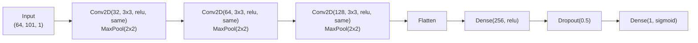

# Design Document: Phone/Codec Robustness for AI Voice Vishing Detection

## Overview

This design covers the full pipeline for building, training, and evaluating a robustness-adapted Mel CNN that detects AI-generated spoofed speech under realistic telephone channel conditions. The project uses the ASVspoof 2019 LA dataset (121,461 audio files across train/dev/eval splits) with three audio conditions: clean (16 kHz), telephone (300-3400 Hz bandpass, 8 kHz), and telephone+G.711 A-law codec (8 kHz with quantization).

Phase 1 established that a clean-trained CNN degrades significantly on telephone conditions (~50% accuracy, ROC-AUC ~0.67-0.69). Phase 2 addresses this by training a robustness model on telephone/codec-conditioned audio with speaker-disjoint splits, comparing three channel conditions, tuning thresholds on validation data, and producing publication-quality analysis.

The design integrates with existing preprocessing modules (`audio_loader.py`, `phone_simulator.py`, `codec_simulator.py`) and metadata files (`phone_conditions_metadata.csv`, `asvspoof2019_la_metadata.csv`).

## Architecture

### High-Level Data Flow

```mermaid
flowchart TD
    subgraph Data Layer
        RAW[ASVspoof 2019 LA FLAC files]
        META[phone_conditions_metadata.csv]
        ASVMETA[asvspoof2019_la_metadata.csv]
    end

    subgraph Preprocessing (Existing)
        AL[audio_loader.py]
        PS[phone_simulator.py]
        CS[codec_simulator.py]
    end

    subgraph Feature Extraction
        ME[mel_extractor.py]
        MDB[mel_dataset_builder.py]
    end

    subgraph Model
        CNN[mel_cnn.py]
        TRAIN[train_robust.py]
    end

    subgraph Evaluation
        CRE[clean_baseline_eval.py]
        PRE[phone_robustness_eval.py]
        CC[condition_comparator.py]
        TT[threshold_tuner.py]
    end

    subgraph Analysis
        DS[domain_shift_analyzer.py]
        PV[pipeline_verifier.py]
        PA[publication_analyzer.py]
    end

    subgraph Data Building
        BPD[build_phone_dataset.py]
        CE[channel_expander.py]
    end

    RAW --> AL
    META --> AL
    AL --> ME
    ASVMETA --> BPD
    BPD --> AL
    ME --> MDB
    MDB --> CNN
    CNN --> TRAIN
    TRAIN --> CRE
    TRAIN --> PRE
    CRE --> CC
    PRE --> CC
    CC --> TT
    DS --> PA
    CC --> PA
    ME --> PV
    CE --> CC
```

### Pipeline Stages

1. **Dataset Building**: Select balanced 500 bonafide + 500 spoof from eval split, generate telephone and telephone+codec audio files
2. **Feature Extraction**: Convert raw audio to 64x101x1 Mel spectrograms with consistent parameters across conditions
3. **Model Definition**: Lightweight CNN for 64x101x1 input with sigmoid output
4. **Robustness Training**: Speaker-disjoint splits, train on telephone/codec conditions
5. **Evaluation**: Clean baseline, telephone, telephone+codec metrics for both clean-trained and robustness models
6. **Threshold Tuning**: Select optimal threshold on validation set, report on test set
7. **Domain Shift Analysis**: Compare Mel spectrogram statistics across conditions
8. **Publication Analysis**: Generate comparison tables, ROC curves, confusion matrices

## Components and Interfaces

### File Structure

```
src/
  __init__.py
  features/
    __init__.py
    mel_extractor.py          # Mel spectrogram extraction (Req 2, 3, 8)
    mel_dataset_builder.py     # Build Mel dataset from metadata CSV (Req 3)
  models/
    __init__.py
    mel_cnn.py                 # CNN model architecture (Req 4)
    train_robust.py            # Robustness training script (Req 10, 11)
  evaluation/
    __init__.py
    clean_baseline_eval.py     # Clean baseline evaluation (Req 7)
    phone_robustness_eval.py   # Phone robustness evaluation (Req 5, 6)
    condition_comparator.py    # Three-condition comparison (Req 12)
    threshold_tuner.py         # Threshold tuning on validation (Req 13)
    domain_shift_analyzer.py   # Domain shift analysis (Req 9)
    pipeline_verifier.py       # Pipeline consistency verification (Req 8)
  data/
    __init__.py
    build_phone_dataset.py     # Build balanced eval dataset (Req 1)
    channel_expander.py        # Additional channel conditions (Req 14)
  analysis/
    __init__.py
    publication_analyzer.py    # Publication-quality output (Req 15)
  utils/
    __init__.py
    metrics.py                 # Shared metrics computation
    plotting.py                # Shared plotting utilities
    splits.py                  # Speaker-disjoint split logic (Req 11)
data/
  processed/
    phone_eval/                # Telephone-condition audio for balanced eval set
    phone_codec_eval/          # Telephone+codec audio for balanced eval set
  results/                     # All evaluation outputs (CSVs, plots)
models/
  mel_cnn_best.keras           # Clean-trained model (from Phase 1)
  mel_cnn_robust_best.keras     # Robustness-trained model (Phase 2)
```

### Component Interfaces

#### mel_extractor.py

```python
def extract_mel_spectrogram(
    audio: np.ndarray,
    sr: int,
    n_mels: int = 64,
    target_frames: int = 101,
    n_fft: int | None = None,
    hop_length: int | None = None,
) -> np.ndarray:
    """
    Extract a Mel spectrogram from audio, returning shape (64, 101, 1).

    Parameters are auto-scaled based on sample rate:
      - 16 kHz: n_fft=2048, hop_length=512
      - 8 kHz:  n_fft=1024, hop_length=256

    Audio is zero-padded or cropped to produce exactly 101 time frames.
    Multi-channel audio is downmixed to mono.

    Returns: np.ndarray of shape (n_mels, target_frames, 1), dtype float32
    """

def get_spectrogram_params(sr: int) -> dict:
    """Return n_fft and hop_length scaled for the given sample rate."""
```

#### mel_dataset_builder.py

```python
class MelDatasetBuilder:
    def __init__(self, metadata_csv: str, audio_loader_func=None):
        """Initialize with path to metadata CSV and optional custom loader."""

    def build_dataset(
        self,
        condition: str = "clean",
        split: str | None = None,
        max_samples: int | None = None,
    ) -> tuple[np.ndarray, np.ndarray]:
        """
        Build (X, y) arrays from metadata.
        X: (N, 64, 101, 1) Mel spectrograms
        y: (N,) binary labels (1=spoof, 0=bonafide)
        """

    def build_generator(self, condition: str, split: str, batch_size: int = 32):
        """Yield batches for memory-efficient training on large splits."""
```

#### mel_cnn.py

```python
def build_mel_cnn(
    input_shape: tuple = (64, 101, 1),
    learning_rate: float = 0.001,
) -> tf.keras.Model:
    """
    Build and compile a lightweight CNN for binary spoof detection.

    Architecture:
      Conv2D(32, 3x3, relu, same) -> MaxPool(2x2)
      Conv2D(64, 3x3, relu, same) -> MaxPool(2x2)
      Conv2D(128, 3x3, relu, same) -> MaxPool(2x2)
      Flatten -> Dense(256, relu) -> Dropout(0.5) -> Dense(1, sigmoid)

    Compiled with Adam optimizer, binary crossentropy loss.
    """
```

#### train_robust.py

```python
class RobustnessTrainer:
    def __init__(
        self,
        metadata_csv: str,
        conditions: list[str] = ["telephone", "telephone_codec"],
        train_split: str = "train",
        val_split: str = "dev",
        test_split: str = "eval",
    ):
        """Initialize trainer with metadata and split configuration."""

    def create_speaker_disjoint_splits(self) -> dict:
        """
        Partition speakers so no speaker appears in more than one split.
        Uses the existing ASVspoof train/dev/eval partition (already speaker-disjoint).
        Returns dict with 'train', 'val', 'test' keys, each containing
        speaker counts and file counts.
        """

    def train(
        self,
        epochs: int = 50,
        batch_size: int = 32,
        output_model_path: str = "models/mel_cnn_robust_best.keras",
    ) -> dict:
        """
        Train the robustness model on telephone/codec audio.
        Logs loss and accuracy per epoch.
        Saves best model (by val_loss) to output path.
        Returns training history dict.
        """
```

#### build_phone_dataset.py

```python
class PhoneRobustnessDatasetBuilder:
    def __init__(
        self,
        metadata_csv: str = "data/metadata/asvspoof2019_la_metadata.csv",
        output_dir: str = "data/processed",
    ):
        """Initialize with source metadata and output directory."""

    def build(self, n_per_class: int = 500) -> str:
        """
        Select balanced 500 bonafide + 500 spoof from eval split.
        Generate telephone and telephone+codec audio files.
        Write metadata CSV to data/metadata/phone_robustness_eval_metadata.csv.
        Skip files too short for required duration, logging each skip.
        Returns path to output metadata CSV.
        """
```

#### metrics.py (shared utilities)

```python
def compute_metrics(
    y_true: np.ndarray,
    y_pred_proba: np.ndarray,
    threshold: float = 0.5,
) -> dict:
    """
    Compute accuracy, precision, recall, F1, ROC-AUC, and confusion matrix.
    Returns dict with all metrics.
    """

def compute_threshold_sweep(
    y_true: np.ndarray,
    y_pred_proba: np.ndarray,
    thresholds: np.ndarray | None = None,
) -> pd.DataFrame:
    """
    Sweep a range of thresholds and return DataFrame with metrics per threshold.
    Default thresholds: np.arange(0.05, 0.96, 0.05).
    """
```

#### splits.py

```python
def verify_speaker_disjoint(
    train_speakers: set,
    val_speakers: set,
    test_speakers: set,
) -> bool:
    """Return True if no speaker appears in more than one set."""

def get_split_report(
    metadata: pd.DataFrame,
    split_col: str = "split",
    speaker_col: str = "speaker_id",
) -> pd.DataFrame:
    """Report unique speakers and file counts per split."""
```

## Data Models

### Metadata Schemas

#### phone_robustness_eval_metadata.csv (Req 1 output)

| Column | Type | Description |
|--------|------|-------------|
| file | str | Original ASVspoof file name (e.g., LA_E_1000137) |
| label | str | "bonafide" or "spoof" |
| split | str | "eval" |
| speaker_id | str | ASVspoof speaker ID (e.g., LA_0079) |
| condition | str | "telephone" or "telephone_codec" |
| output_path | str | Path to generated WAV file |
| sample_rate | int | 8000 |
| codec | str | "none" or "G711_alaw" |
| duration_sec | float | Duration of the generated audio |

### Mel Spectrogram Tensor

| Property | Value |
|----------|-------|
| Shape | (64, 101, 1) |
| Dtype | float32 |
| Mel bins | 64 |
| Time frames | 101 |
| Channels | 1 (grayscale) |
| Value range | log-scaled Mel power (typically 0 to ~10) |

### CNN Model Architecture



Layer dimensions through the network:

| Layer | Output Shape | Parameters |
|-------|-------------|------------|
| Input | (64, 101, 1) | 0 |
| Conv2D(32, 3x3) | (64, 101, 32) | 320 |
| MaxPool2D(2x2) | (32, 50, 32) | 0 |
| Conv2D(64, 3x3) | (32, 50, 64) | 18,496 |
| MaxPool2D(2x2) | (16, 25, 64) | 0 |
| Conv2D(128, 3x3) | (16, 25, 128) | 73,856 |
| MaxPool2D(2x2) | (8, 12, 128) | 0 |
| Flatten | (12,288) | 0 |
| Dense(256) | (256) | 3,145,984 |
| Dropout(0.5) | (256) | 0 |
| Dense(1) | (1) | 257 |

Total parameters: ~3.24M (lightweight, trainable on single GPU or CPU)

### Mel Spectrogram Parameter Scaling

The key design decision is scaling STFT parameters with sample rate to maintain consistent time resolution per frame:

| Parameter | 16 kHz (clean) | 8 kHz (telephone/codec) | Ratio |
|-----------|----------------|-------------------------|-------|
| n_fft | 2048 | 1024 | 2:1 |
| hop_length | 512 | 256 | 2:1 |
| n_mels | 64 | 64 | 1:1 |
| Frame duration | 128 ms | 128 ms | 1:1 |
| Hop duration | 32 ms | 32 ms | 1:1 |
| Audio for 101 frames | 53,248 samples (3.328s) | 26,624 samples (3.328s) | 2:1 |
| Frequency resolution | 7.8125 Hz | 7.8125 Hz | 1:1 |

This ensures the same temporal and frequency resolution across conditions, so the only difference is the available bandwidth (0-8 kHz for clean vs 0-4 kHz for telephone). The 64 Mel bins span the full Nyquist range for each condition, meaning telephone spectrograms encode only the 0-4 kHz band while clean spectrograms encode 0-8 kHz.

### Training Data Flow

```mermaid
flowchart TD
    subgraph ASVspoof Splits (Speaker-Disjoint)
        TRAIN_SPLIT["Train Split\n25,380 files\nSpeakers: train-only"]
        DEV_SPLIT["Dev Split\n24,844 files\nSpeakers: dev-only"]
        EVAL_SPLIT["Eval Split\n71,237 files\nSpeakers: eval-only"]
    end

    TRAIN_SPLIT -->|"telephone + telephone_codec"| TRAIN_DATA["Training Data\nMulti-condition Mel spectrograms"]
    DEV_SPLIT -->|"telephone + telephone_codec"| VAL_DATA["Validation Data\nFor threshold tuning + early stopping"]
    EVAL_SPLIT -->|"balanced 1,000 subset"| TEST_DATA["Test Data\nPhone robustness eval set"]

    TRAIN_DATA --> MODEL["Robustness CNN"]
    VAL_DATA -->|"monitor val_loss"| MODEL
    MODEL --> BEST["mel_cnn_robust_best.keras"]
    BEST --> EVAL["Evaluate on test data"]
    VAL_DATA --> TUNE["Tune threshold on validation"]
    TUNE --> EVAL
    TEST_DATA --> EVAL
```

## Error Handling

| Scenario | Handling |
|----------|----------|
| Audio file not found (Req 1.5) | Skip file, log to skip log, continue processing |
| Audio too short for required duration (Req 1.5, 2.5) | Skip for dataset building; zero-pad for feature extraction |
| Telephone extraction fails but codec succeeds (Req 5.4) | Proceed with codec results only, flag telephone as missing |
| Model file not found (Req 5.1) | Raise FileNotFoundError with clear message |
| Empty prediction array | Return zero-count metrics with NaN for undefined ratios |
| Speaker overlap detected (Req 11) | Raise ValueError before training begins |

## Testing Strategy

### Dual Testing Approach

- **Unit tests**: Verify specific examples, edge cases (short audio, mono downmix, padding behavior), and integration points between components
- **Property tests**: Verify universal properties across all inputs (shape consistency, speaker-disjoint invariant, filter correctness, label consistency)
- Both are complementary and necessary for comprehensive coverage

### Property-Based Testing

**Library**: [Hypothesis](https://hypothesis.readthedocs.io/) — the standard property-based testing library for Python. It integrates well with pytest and automatically shrinks failing cases to minimal counterexamples.

**Configuration**:
- Minimum 100 iterations per property test (Hypothesis default, using `@settings(max_examples=100)`)
- Each property test must reference its design document property in a comment with format: `# Feature: phone-codec-robustness, Property N: <property_text>`
- Property tests live in `tests/property/` alongside unit tests in `tests/unit/`

**Property-Based Testing Scope**

Property-based testing applies to the pure-function components of this pipeline:

1. **Mel spectrogram extraction** (`mel_extractor.py`) — pure function with clear input/output, universal shape invariant, mono downmix equivalence
2. **Speaker-disjoint split verification** (`splits.py`) — pure function with set-membership invariant
3. **Pipeline shape consistency** (`pipeline_verifier.py`) — universal invariant across all conditions
4. **Dataset builder filtering** (`mel_dataset_builder.py`) — filter correctness and label-metadata consistency
5. **Balanced dataset selection** (`build_phone_dataset.py`) — class balance and split membership invariant
6. **Channel expander labeling** (`channel_expander.py`) — condition label uniqueness invariant

**Property Test Implementations**:

| Property | Test File | What Varies | What's Verified |
|----------|----------|------------|-----------------|
| Property 1: Shape invariant | `tests/property/test_mel_extractor.py` | Audio length, sample rate (8k/16k), channel count | Output always (64, 101, 1) |
| Property 2: Mono downmix | `tests/property/test_mel_extractor.py` | Number of channels, audio content | Multi-channel result equals mono downmix result |
| Property 3: Balanced selection | `tests/property/test_build_phone_dataset.py` | Metadata content, label distribution | Exactly 500 bonafide + 500 spoof from eval split |
| Property 4: Label consistency | `tests/property/test_mel_dataset_builder.py` | Metadata rows, labels | Each spectrogram label matches metadata |
| Property 5: Filter correctness | `tests/property/test_mel_dataset_builder.py` | Condition values, split values, filter criteria | All returned entries match filter |
| Property 6: Verifier report | `tests/property/test_pipeline_verifier.py` | Audio conditions, shapes (valid/invalid) | Report generated, flag set correctly |
| Property 7: Speaker-disjoint | `tests/property/test_splits.py` | Speaker assignments, split boundaries | No speaker in >1 split |
| Property 8: Label uniqueness | `tests/property/test_channel_expander.py` | Condition names, number of conditions | All labels distinct |

**PBT does NOT apply to**:
- CNN model training (external TensorFlow framework, stochastic, expensive)
- Audio file I/O (side-effect operations)
- Plot generation (visual output, not testable as property)
- Metric computation (delegates to sklearn, already tested by authors)
- Threshold sweep computation (pure function but behavior is deterministic per threshold — covered by unit tests)

### Unit Tests

Unit tests verify specific examples, edge cases, and component integration points:

| Component | Test File | Test Cases |
|-----------|----------|------------|
| `mel_extractor.py` | `tests/unit/test_mel_extractor.py` | Known audio produces expected spectrogram values; 16 kHz vs 8 kHz parameter scaling; very short audio (100 samples) padded correctly; silence input produces near-zero spectrogram |
| `mel_cnn.py` | `tests/unit/test_mel_cnn.py` | Model input shape (64, 101, 1); output is single sigmoid; loss is binary crossentropy; optimizer is Adam; parameter count < 5M |
| `metrics.py` | `tests/unit/test_metrics.py` | Known y_true/y_pred produce hand-calculated accuracy/precision/recall/F1; ROC-AUC of perfect predictions = 1.0; empty predictions return NaN ratios |
| `splits.py` | `tests/unit/test_splits.py` | Overlapping speakers detected and rejected; split report contains correct counts |
| `build_phone_dataset.py` | `tests/unit/test_build_phone_dataset.py` | Metadata CSV has required columns; short audio files are skipped and logged |
| `threshold_tuner.py` | `tests/unit/test_threshold_tuner.py` | Both 0.5 and tuned threshold results reported; tuned threshold from validation only |

### Integration Tests

Integration tests verify multi-component flows with real or mocked I/O:

| Flow | Test File | What's Verified |
|------|----------|-----------------|
| Dataset build + file generation | `tests/integration/test_build_phone_dataset.py` | 3-5 files generate telephone and codec WAVs at 8 kHz; metadata CSV written with correct columns |
| Clean baseline evaluation | `tests/integration/test_clean_baseline_eval.py` | Predictions in [0,1] on small clean subset; metrics CSV written |
| Phone robustness evaluation | `tests/integration/test_phone_robustness_eval.py` | Predictions on telephone + codec subset; results CSVs written; missing condition flagged |
| Robustness training (tiny) | `tests/integration/test_train_robust.py` | 2-3 files, 1 epoch; model saved; history has loss/accuracy keys |
| Condition comparison | `tests/integration/test_condition_comparator.py` | Both clean-trained and robustness-trained metrics reported for 3 conditions; CSV written |
| Threshold tuning | `tests/integration/test_threshold_tuner.py` | Threshold selected from validation; comparison CSV written |
| Domain shift analysis | `tests/integration/test_domain_shift_analyzer.py` | Statistics computed for 3 conditions; distribution difference metric non-negative; plots saved |
| Publication analysis | `tests/integration/test_publication_analyzer.py` | Comparison tables generated; ROC curves saved; confusion matrices saved; ablation skipped when no extra conditions |
| Channel expansion | `tests/integration/test_channel_expander.py` | Additional condition audio generated; per-condition metrics reported |

### Smoke Tests

| Check | Test File | What's Verified |
|-------|----------|-----------------|
| Model file exists | `tests/integration/test_phone_robustness_eval.py` | `models/mel_cnn_best.keras` loads with input (64, 101, 1) |
| Metadata exists | `tests/integration/test_phone_robustness_eval.py` | `phone_robustness_eval_metadata.csv` has 1,000 rows |
| Training script exists | `tests/integration/test_train_robust.py` | `train_robust.py` can be instantiated |

### Test Directory Structure

```
tests/
  __init__.py
  conftest.py                 # Shared fixtures (sample audio, mock metadata)
  unit/
    __init__.py
    test_mel_extractor.py
    test_mel_cnn.py
    test_metrics.py
    test_splits.py
    test_build_phone_dataset.py
    test_threshold_tuner.py
  property/
    __init__.py
    test_mel_extractor.py     # Properties 1, 2
    test_mel_dataset_builder.py  # Properties 4, 5
    test_pipeline_verifier.py # Property 6
    test_splits.py            # Property 7
    test_build_phone_dataset.py  # Property 3
    test_channel_expander.py # Property 8
  integration/
    __init__.py
    test_build_phone_dataset.py
    test_clean_baseline_eval.py
    test_phone_robustness_eval.py
    test_train_robust.py
    test_condition_comparator.py
    test_threshold_tuner.py
    test_domain_shift_analyzer.py
    test_publication_analyzer.py
    test_channel_expander.py
```

## Correctness Properties

*A property is a characteristic or behavior that should hold true across all valid executions of a system — essentially, a formal statement about what the system should do. Properties serve as the bridge between human-readable specifications and machine-verifiable correctness guarantees.*

### Property 1: Mel spectrogram shape invariant

*For any* audio array (regardless of length, sample rate, channel count, or condition), THE Mel_Spectrogram_Extractor SHALL produce a tensor with shape (64, 101, 1).

This property subsumes:
- 2.1 (accepts any audio array and sample rate)
- 2.2 (output shape is 64x101x1)
- 2.4 (consistent shape across clean, telephone, telephone_codec conditions)
- 2.5 (short audio is padded to produce expected shape)
- 8.1, 8.2, 8.3 (telephone, telephone_codec, and clean conditions all produce (64, 101, 1))

**Validates: Requirements 2.1, 2.2, 2.4, 2.5, 8.1, 8.2, 8.3**

### Property 2: Mono downmix equivalence

*For any* multi-channel audio array, the Mel spectrogram of the multi-channel audio SHALL be equal to the Mel spectrogram of its mono downmix (channel-averaged version).

**Validates: Requirements 2.3**

### Property 3: Balanced dataset selection

*For any* execution of the balanced dataset builder, the selected set SHALL contain exactly 500 bonafide and 500 spoof files, all from the ASVspoof_2019_LA eval split.

**Validates: Requirements 1.1**

### Property 4: Label-metadata consistency

*For any* Mel spectrogram dataset built from a metadata CSV, each spectrogram SHALL be associated with the label from its corresponding metadata row.

**Validates: Requirements 3.2**

### Property 5: Filter correctness

*For any* metadata dataset filtered by condition or split, all returned entries SHALL match the specified filter criteria.

**Validates: Requirements 3.3**

### Property 6: Pipeline verifier consistency report

*For any* set of audio conditions passed to the pipeline verifier, the verifier SHALL produce a report indicating whether all conditions produce (64, 101, 1) output, and SHALL set the pipeline_verified flag to true if and only if no discrepancy is found.

**Validates: Requirements 8.4**

### Property 7: Speaker-disjoint split invariant

*For any* data split configuration created by the Robustness_Trainer, no speaker SHALL appear in more than one of the train, validation, or test sets.

This property subsumes:
- 11.2 (test set kept separate from training and validation — implied by no speaker overlap)

**Validates: Requirements 11.1, 11.2**

### Property 8: Condition label uniqueness

*For any* set of additional channel conditions generated by the Channel_Expander, each condition SHALL have a distinct label in the metadata.

**Validates: Requirements 14.2**
