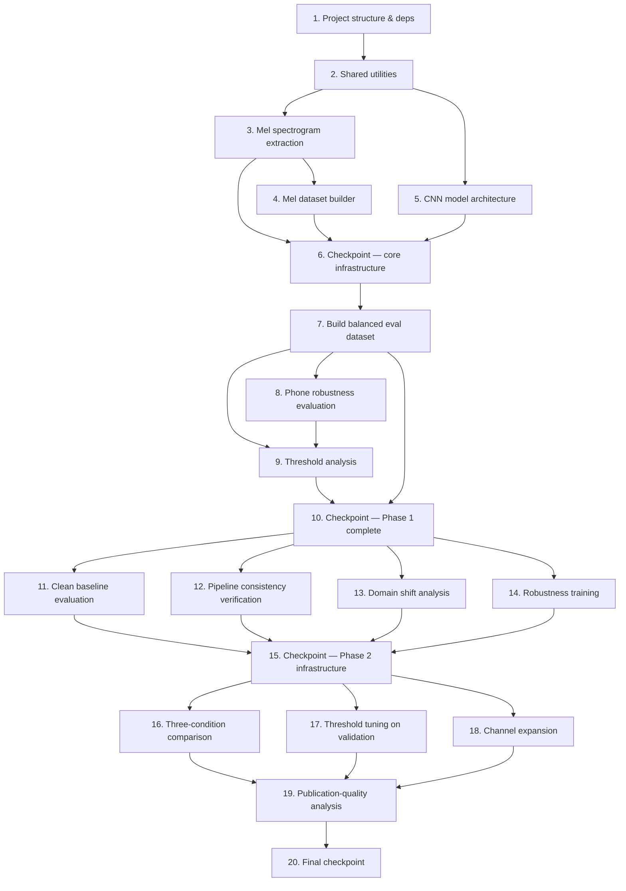

# Implementation Plan: Phone/Codec Robustness for AI Voice Vishing Detection

## Overview

This plan implements a full pipeline for evaluating and improving spoofed-speech detection under realistic telephone channel conditions. It covers two phases: (1) replicating the baseline pipeline (balanced dataset, Mel spectrogram extraction, CNN model, evaluation, threshold analysis) and (2) robustness adaptation (clean baseline, domain shift, robustness training, condition comparison, threshold tuning, channel expansion, publication analysis).

The design specifies Python as the implementation language, with TensorFlow/Keras for the CNN model, librosa for audio processing, and Hypothesis for property-based testing.

Existing modules to reuse (do NOT duplicate): `preprocessing/audio_loader.py` (load_audio, telephone_filter, apply_alaw, normalize), `preprocessing/codec_simulator.py` (alaw_encode, alaw_decode), `preprocessing/phone_simulator.py` (telephone_filter, simulate_phone), `preprocessing/create_phone_metadata.py` (phone_conditions_metadata.csv generation), and existing metadata files (`data/metadata/asvspoof2019_la_metadata.csv`, `data/metadata/phone_conditions_metadata.csv`).

The design specifies a `src/` package structure. All new code goes under `src/` with sub-packages for features, models, evaluation, data, analysis, and utils.

## Tasks

- [ ] 1. Set up project structure and dependencies
  - Create `src/` package with `__init__.py` and sub-packages: `features/`, `models/`, `evaluation/`, `data/`, `analysis/`, `utils/`, each with `__init__.py`
  - Create `tests/` directory with `__init__.py`, `conftest.py`, and sub-directories: `unit/`, `property/`, `integration/`, each with `__init__.py`
  - Update `requirements.txt` to add `tensorflow>=2.15,<2.17` (or `tensorflow-cpu` alternative) and `hypothesis>=6.0`
  - Create `data/processed/phone_eval/`, `data/processed/phone_codec_eval/`, and `data/results/` directories (with `.gitkeep`)
  - _Requirements: 16.1, 16.2_

- [ ] 2. Implement shared utility modules
  - [ ] 2.1 Create `src/utils/metrics.py` with `compute_metrics(y_true, y_pred_proba, threshold=0.5)` returning dict (accuracy, precision, recall, F1, ROC-AUC, confusion matrix) and `compute_threshold_sweep(y_true, y_pred_proba, thresholds=None)` returning DataFrame
    - Use sklearn metrics (accuracy_score, precision_score, recall_score, f1_score, roc_auc_score, confusion_matrix)
    - Handle empty predictions by returning NaN for undefined ratios
    - _Requirements: 5.5, 6.2_

  - [ ] 2.2 Create `src/utils/splits.py` with `verify_speaker_disjoint(train_speakers, val_speakers, test_speakers)` returning bool and `get_split_report(metadata, split_col, speaker_col)` returning DataFrame
    - Raise ValueError on overlap detection (used by trainer as guard)
    - Report unique speaker counts and file counts per split
    - _Requirements: 11.1, 11.2, 11.3_

  - [ ] 2.3 Create `src/utils/plotting.py` with helper functions for ROC curves, confusion matrix heatmaps, and statistic distribution plots
    - Reuse matplotlib for all plotting
    - Save figures to `data/results/`
    - _Requirements: 9.3, 15.2, 15.3_

  - [ ]* 2.4 Write unit tests for `metrics.py`
    - Test known y_true/y_pred produce hand-calculated accuracy/precision/recall/F1
    - Test ROC-AUC of perfect predictions = 1.0
    - Test empty predictions return NaN ratios
    - _Requirements: 5.5_

  - [ ]* 2.5 Write unit tests for `splits.py`
    - Test overlapping speakers detected and rejected
    - Test split report contains correct counts
    - _Requirements: 11.1, 11.3_

  - [ ]* 2.6 Write property test for speaker-disjoint invariant
    - **Property 7: Speaker-disjoint split invariant**
    - **Validates: Requirements 11.1, 11.2**
    - # Feature: phone-codec-robustness, Property 7: For any data split configuration, no speaker appears in more than one of train/val/test sets

  - [ ]* 2.7 Write unit tests for `plotting.py`
    - Test that plot functions return file paths to saved figures
    - Test ROC curve function accepts arrays and produces a plot file
    - _Requirements: 15.2, 15.3_

- [ ] 3. Implement Mel spectrogram feature extraction
  - [ ] 3.1 Create `src/features/mel_extractor.py` with `extract_mel_spectrogram(audio, sr, n_mels=64, target_frames=101, n_fft=None, hop_length=None)` and `get_spectrogram_params(sr)` 
    - Auto-scale STFT params by sample rate: 16kHz → n_fft=2048, hop=512; 8kHz → n_fft=1024, hop=256
    - Downmix multi-channel audio to mono by averaging channels
    - Zero-pad or crop audio to produce exactly `target_frames` time frames
    - Return np.ndarray of shape (n_mels, target_frames, 1), dtype float32
    - Apply log-scaled Mel power spectrogram
    - _Requirements: 2.1, 2.2, 2.3, 2.4, 2.5_

  - [ ]* 3.2 Write unit tests for `mel_extractor.py`
    - Test known audio produces expected spectrogram values
    - Test 16 kHz vs 8 kHz parameter scaling (n_fft and hop_length halved at 8 kHz)
    - Test very short audio (100 samples) is padded to produce (64, 101, 1)
    - Test silence input produces near-zero spectrogram
    - _Requirements: 2.2, 2.5_

  - [ ]* 3.3 Write property test for Mel spectrogram shape invariant
    - **Property 1: Mel spectrogram shape invariant**
    - **Validates: Requirements 2.1, 2.2, 2.4, 2.5, 8.1, 8.2, 8.3**
    - # Feature: phone-codec-robustness, Property 1: For any audio array regardless of length, sample rate, channel count, or condition, the extractor produces (64, 101, 1)

  - [ ]* 3.4 Write property test for mono downmix equivalence
    - **Property 2: Mono downmix equivalence**
    - **Validates: Requirements 2.3**
    - # Feature: phone-codec-robustness, Property 2: For any multi-channel audio, the Mel spectrogram equals that of its mono downmix

- [ ] 4. Implement Mel dataset builder
  - [ ] 4.1 Create `src/features/mel_dataset_builder.py` with `MelDatasetBuilder` class
    - `__init__(metadata_csv, audio_loader_func=None)` — reads metadata CSV, defaults to `preprocessing.audio_loader.load_audio`
    - `build_dataset(condition="clean", split=None, max_samples=None)` → returns (X, y) arrays; X shape (N, 64, 101, 1), y shape (N,) binary (1=spoof, 0=bonafide)
    - `build_generator(condition, split, batch_size=32)` — yields (X_batch, y_batch) for memory-efficient training on large splits
    - Filter metadata by condition (clean/telephone/telephone_codec) and split (train/dev/eval)
    - Map label strings ("bonafide"→0, "spoof"→1)
    - _Requirements: 3.1, 3.2, 3.3_

  - [ ]* 4.2 Write property test for label-metadata consistency
    - **Property 4: Label-metadata consistency**
    - **Validates: Requirements 3.2**
    - # Feature: phone-codec-robustness, Property 4: For any Mel dataset built from metadata CSV, each spectrogram label matches its metadata row

  - [ ]* 4.3 Write property test for filter correctness
    - **Property 5: Filter correctness**
    - **Validates: Requirements 3.3**
    - # Feature: phone-codec-robustness, Property 5: For any metadata dataset filtered by condition or split, all returned entries match the filter criteria

- [ ] 5. Implement CNN model architecture
  - [ ] 5.1 Create `src/models/mel_cnn.py` with `build_mel_cnn(input_shape=(64, 101, 1), learning_rate=0.001)` returning compiled tf.keras.Model
    - Architecture: Conv2D(32, 3x3, relu, same) → MaxPool(2x2) → Conv2D(64, 3x3, relu, same) → MaxPool(2x2) → Conv2D(128, 3x3, relu, same) → MaxPool(2x2) → Flatten → Dense(256, relu) → Dropout(0.5) → Dense(1, sigmoid)
    - Compile with Adam optimizer (learning_rate), binary crossentropy loss, metrics=['accuracy']
    - Total params ~3.24M (lightweight)
    - _Requirements: 4.1, 4.2, 4.3, 4.4_

  - [ ]* 5.2 Write unit tests for `mel_cnn.py`
    - Test model input shape (64, 101, 1)
    - Test output is single sigmoid (shape (1,))
    - Test loss is binary crossentropy
    - Test optimizer is Adam
    - Test parameter count < 5M
    - _Requirements: 4.1, 4.2, 4.3, 4.4_

- [ ] 6. Checkpoint — core infrastructure ready
  - Ensure all tests pass, ask the user if questions arise.
  - Verify: mel_extractor, mel_dataset_builder, mel_cnn, metrics, splits, plotting are all importable and unit/property tests pass

- [ ] 7. Build balanced phone robustness evaluation dataset
  - [ ] 7.1 Create `src/data/build_phone_dataset.py` with `PhoneRobustnessDatasetBuilder` class
    - `__init__(metadata_csv="data/metadata/asvspoof2019_la_metadata.csv", output_dir="data/processed")`
    - `build(n_per_class=500)` → selects 500 bonafide + 500 spoof from eval split; generates telephone and telephone+codec WAV files; writes `data/metadata/phone_robustness_eval_metadata.csv` with columns: file, label, split, speaker_id, condition, output_path, sample_rate, codec, duration_sec
    - Reuse `preprocessing/audio_loader.load_audio()` to generate telephone and telephone_codec audio (it already applies bandpass + resample + A-law)
    - Save generated audio to `data/processed/phone_eval/` (telephone) and `data/processed/phone_codec_eval/` (telephone_codec) as WAV files
    - Skip files too short for required duration (catch ValueError from load_audio), log each skip
    - Return path to output metadata CSV
    - _Requirements: 1.1, 1.2, 1.3, 1.4, 1.5_

  - [ ]* 7.2 Write property test for balanced dataset selection
    - **Property 3: Balanced dataset selection**
    - **Validates: Requirements 1.1**
    - # Feature: phone-codec-robustness, Property 3: For any execution of the balanced dataset builder, the selected set contains exactly 500 bonafide and 500 spoof files from eval split

  - [ ]* 7.3 Write unit tests for `build_phone_dataset.py`
    - Test metadata CSV has required columns (file, label, split, speaker_id, condition, output_path, sample_rate, codec, duration_sec)
    - Test short audio files are skipped and logged
    - _Requirements: 1.4, 1.5_

  - [ ]* 7.4 Write integration test for dataset build + file generation
    - Test 3-5 files generate telephone and codec WAVs at 8 kHz
    - Test metadata CSV written with correct columns
    - _Requirements: 1.2, 1.3, 1.4_

- [ ] 8. Evaluate phone robustness of clean-trained model
  - [ ] 8.1 Create `src/evaluation/phone_robustness_eval.py` with `PhoneRobustnessEvaluator` class
    - `__init__(model_path="models/mel_cnn_best.keras", metadata_csv="data/metadata/phone_robustness_eval_metadata.csv")`
    - `evaluate()` → loads model, loads balanced metadata, extracts Mel spectrograms for telephone and telephone_codec conditions, produces spoof probabilities
    - If telephone extraction fails but codec succeeds, proceed with codec results only and flag telephone as missing
    - Compute accuracy, precision, recall, F1, ROC-AUC, confusion matrices, classification reports for both conditions
    - Write results to `data/results/phone_robustness_summary.csv` and `data/results/phone_robustness_detailed.csv`
    - Reuse `src/utils/metrics.compute_metrics()` and `src/features/mel_extractor.extract_mel_spectrogram()`
    - Reuse `preprocessing/audio_loader.load_audio()` for loading audio under conditions
    - _Requirements: 5.1, 5.2, 5.3, 5.4, 5.5, 5.6, 5.7_

  - [ ]* 8.2 Write integration test for phone robustness evaluation
    - Test predictions in [0,1] on small telephone + codec subset
    - Test results CSVs written
    - Test missing condition is flagged when telephone fails
    - Test model file loads with input (64, 101, 1)
    - _Requirements: 5.3, 5.4, 5.7_

- [ ] 9. Analyze decision thresholds
  - [ ] 9.1 Create `src/evaluation/threshold_analyzer.py` (or `src/features/analyze_phone_thresholds.py`) with threshold sweep logic
    - Collect 2,000 predictions across telephone and telephone_codec conditions (1,000 per condition from the balanced eval set)
    - Test threshold range (default: np.arange(0.05, 0.96, 0.05)) and compute accuracy, precision, recall, F1 for each
    - Write results to `data/results/phone_threshold_analysis.csv`
    - Reuse `src/utils/metrics.compute_threshold_sweep()`
    - _Requirements: 6.1, 6.2, 6.3_

  - [ ]* 9.2 Write unit tests for threshold analysis
    - Test that sweep produces a row per threshold value
    - Test that 2,000 predictions are collected across both conditions
    - _Requirements: 6.1, 6.2_

- [ ] 10. Checkpoint — Phase 1 complete
  - Ensure all tests pass, ask the user if questions arise.
  - Verify: balanced dataset built, Mel extraction works, CNN model builds, clean-trained model evaluates on phone conditions, threshold analysis runs

- [ ] 11. Evaluate and preserve clean baseline
  - [ ] 11.1 Create `src/evaluation/clean_baseline_eval.py` with `CleanBaselineEvaluator` class
    - `__init__(model_path="models/mel_cnn_best.keras", metadata_csv="data/metadata/asvspoof2019_la_metadata.csv")`
    - `evaluate(max_samples=None)` → extracts Mel spectrograms from clean-condition audio, runs Mel CNN to produce spoof probabilities
    - Compute accuracy, precision, recall, F1, ROC-AUC, confusion matrix
    - Persist results to `data/results/clean_baseline_results.csv` (structured CSV enabling direct comparison with telephone/codec results)
    - Reuse `src/features/mel_dataset_builder.MelDatasetBuilder` with condition="clean"
    - _Requirements: 7.1, 7.2, 7.3_

  - [ ]* 11.2 Write integration test for clean baseline evaluation
    - Test predictions in [0,1] on small clean subset
    - Test metrics CSV written with expected columns
    - _Requirements: 7.1, 7.2, 7.3_

- [ ] 12. Verify Mel pipeline consistency across conditions
  - [ ] 12.1 Create `src/evaluation/pipeline_verifier.py` with `PipelineVerifier` class
    - `verify(audio_files, conditions=["clean", "telephone", "telephone_codec"])` → extracts Mel spectrograms for each condition, confirms output shape is (64, 101, 1) for all
    - Generate report confirming consistency or reporting any shape/value-range discrepancies
    - Set `pipeline_verified` flag to True when no discrepancy found, False otherwise
    - Reuse `src/features/mel_extractor.extract_mel_spectrogram()` and `preprocessing/audio_loader.load_audio()`
    - _Requirements: 8.1, 8.2, 8.3, 8.4_

  - [ ]* 12.2 Write property test for pipeline verifier consistency report
    - **Property 6: Pipeline verifier consistency report**
    - **Validates: Requirements 8.4**
    - # Feature: phone-codec-robustness, Property 6: For any set of audio conditions, the verifier produces a report and sets pipeline_verified to true iff no discrepancy

- [ ] 13. Investigate domain shift between clean and telephone conditions
  - [ ] 13.1 Create `src/evaluation/domain_shift_analyzer.py` with `DomainShiftAnalyzer` class
    - `analyze(metadata_csv, conditions=["clean", "telephone", "telephone_codec"], max_samples=200)` → computes per-bin Mel spectrogram statistics (mean, std) for each condition
    - Compute quantitative distribution difference metric between clean and telephone conditions (e.g., mean absolute difference per Mel bin, KL divergence, or Wasserstein distance)
    - Generate visual comparison plots: Mel spectrogram examples per condition, per-bin mean/std distributions
    - Save plots to `data/results/` (e.g., `domain_shift_mel_examples.png`, `domain_shift_per_bin_stats.png`)
    - Reuse `src/features/mel_extractor.extract_mel_spectrogram()` and `src/utils/plotting.py`
    - _Requirements: 9.1, 9.2, 9.3_

  - [ ]* 13.2 Write integration test for domain shift analysis
    - Test statistics computed for all 3 conditions
    - Test distribution difference metric is non-negative
    - Test plots saved to `data/results/`
    - _Requirements: 9.1, 9.2, 9.3_

- [ ] 14. Train robustness adaptation model
  - [ ] 14.1 Create `src/models/train_robust.py` with `RobustnessTrainer` class
    - `__init__(metadata_csv="data/metadata/phone_conditions_metadata.csv", conditions=["telephone", "telephone_codec"], train_split="train", val_split="dev", test_split="eval")`
    - `create_speaker_disjoint_splits()` → verify ASVspoof train/dev/eval are already speaker-disjoint using `src/utils/splits.verify_speaker_disjoint()` and `get_split_report()`; raise ValueError on overlap; return dict with train/val/test keys containing speaker and file counts
    - `train(epochs=50, batch_size=32, output_model_path="models/mel_cnn_robust_best.keras")` → builds Mel CNN via `src/models/mel_cnn.build_mel_cnn()`, trains on telephone+codec audio using `MelDatasetBuilder.build_generator()`, monitors val_loss with early stopping, saves best model to output path
    - Log training metrics (loss, accuracy) per epoch to enable convergence verification (return training history dict)
    - _Requirements: 10.1, 10.2, 10.3, 11.1, 11.2, 11.3_

  - [ ]* 14.2 Write integration test for robustness training
    - Test with 2-3 files, 1 epoch
    - Test model saved to disk
    - Test training history has loss and accuracy keys
    - Test training script can be instantiated
    - _Requirements: 10.2, 10.3_

- [ ] 15. Checkpoint — Phase 2 infrastructure ready
  - Ensure all tests pass, ask the user if questions arise.
  - Verify: clean baseline evaluated, pipeline verified, domain shift analyzed, robustness model trained

- [ ] 16. Compare three channel conditions
  - [ ] 16.1 Create `src/evaluation/condition_comparator.py` with `ConditionComparator` class
    - `__init__(clean_model_path="models/mel_cnn_best.keras", robust_model_path="models/mel_cnn_robust_best.keras", metadata_csv="data/metadata/phone_robustness_eval_metadata.csv")`
    - `compare()` → evaluates both clean-trained and robustness-trained models on clean, telephone, and telephone_codec conditions
    - Report accuracy, precision, recall, F1, ROC-AUC, and confusion matrices for all 3 conditions × both models
    - Write results to structured CSV in `data/results/condition_comparison.csv`
    - Reuse `src/utils/metrics.compute_metrics()`, `src/features/mel_dataset_builder.MelDatasetBuilder`, and `src/features/mel_extractor`
    - _Requirements: 12.1, 12.2, 12.3_

  - [ ]* 16.2 Write integration test for condition comparison
    - Test both clean-trained and robustness-trained metrics reported for 3 conditions
    - Test CSV written with comparison data
    - _Requirements: 12.1, 12.2, 12.3_

- [ ] 17. Tune operating threshold on validation set
  - [ ] 17.1 Create `src/evaluation/threshold_tuner.py` with `ThresholdTuner` class
    - `__init__(model_path="models/mel_cnn_robust_best.keras", metadata_csv="data/metadata/phone_conditions_metadata.csv")`
    - `tune(val_condition="telephone", test_condition="telephone_codec")` → selects optimal threshold using validation set predictions only (sweep thresholds on val predictions, pick best F1)
    - Report both default 0.5 threshold results and validation-derived threshold results on the test set
    - Write threshold comparison results to `data/results/threshold_tuning_results.csv`
    - Reuse `src/utils/metrics.compute_threshold_sweep()` and `compute_metrics()`
    - _Requirements: 13.1, 13.2, 13.3_

  - [ ]* 17.2 Write unit tests for `threshold_tuner.py`
    - Test both 0.5 and tuned threshold results reported
    - Test tuned threshold is selected from validation predictions only (not test)
    - _Requirements: 13.1, 13.2_

  - [ ]* 17.3 Write integration test for threshold tuning
    - Test threshold selected from validation set
    - Test comparison CSV written
    - _Requirements: 13.1, 13.2, 13.3_

- [ ] 18. Expand codec and channel robustness conditions
  - [ ] 18.1 Create `src/data/channel_expander.py` with `ChannelExpander` class
    - `__init__(metadata_csv="data/metadata/asvspoof2019_la_metadata.csv", output_dir="data/processed")`
    - `expand(n_per_class=100)` → applies at least one additional degradation type (additive noise, bandwidth variation, or alternative codec/bit-rate) to audio files
    - Keep each condition separately labeled in the metadata (distinct condition names)
    - `evaluate(model_path, conditions)` → reports performance metrics for each condition separately
    - Reuse `preprocessing/audio_loader.load_audio()` as base, apply additional degradation on top
    - _Requirements: 14.1, 14.2, 14.3_

  - [ ]* 18.2 Write property test for condition label uniqueness
    - **Property 8: Condition label uniqueness**
    - **Validates: Requirements 14.2**
    - # Feature: phone-codec-robustness, Property 8: For any set of additional channel conditions, each condition has a distinct label in the metadata

  - [ ]* 18.3 Write integration test for channel expansion
    - Test additional condition audio generated
    - Test per-condition metrics reported separately
    - _Requirements: 14.1, 14.3_

- [ ] 19. Generate publication-quality analysis
  - [ ] 19.1 Create `src/analysis/publication_analyzer.py` with `PublicationAnalyzer` class
    - `__init__(comparison_csv="data/results/condition_comparison.csv", threshold_csv="data/results/threshold_tuning_results.csv")`
    - `generate()` → creates:
      - Comparison tables showing clean baseline, telephone, and telephone_codec metrics for both clean-trained and robustness-trained models
      - ROC curve plots for all conditions (reuse `src/utils/plotting.py`)
      - Confusion matrix visualizations for all conditions
      - If additional channel conditions have been evaluated: ablation table; if not: skip ablation table generation entirely
    - Save all plots and tables to `data/results/`
    - _Requirements: 15.1, 15.2, 15.3, 15.4, 15.5_

  - [ ]* 19.2 Write integration test for publication analysis
    - Test comparison tables generated
    - Test ROC curves saved as image files
    - Test confusion matrices saved as image files
    - Test ablation table skipped when no extra conditions
    - _Requirements: 15.1, 15.2, 15.3, 15.4, 15.5_

- [ ] 20. Final checkpoint — all components integrated
  - Ensure all tests pass, ask the user if questions arise.
  - Verify: full pipeline runs end-to-end — dataset build → feature extraction → model training → evaluation → comparison → threshold tuning → publication analysis
  - Confirm all 8 property tests pass with minimum 100 iterations each
  - Confirm all unit and integration tests pass

## Task Dependency Graph



```json
{
  "waves": [
    [1],
    [2, 3, 5],
    [4, 6],
    [7],
    [8, 9],
    [10],
    [11, 12, 13, 14],
    [15],
    [16, 17, 18],
    [19],
    [20]
  ]
}
```

## Notes

- Tasks marked with `*` are optional and can be skipped for faster MVP
- Each task references specific requirements for traceability
- Checkpoints ensure incremental validation at natural break points
- Property tests validate universal correctness properties (8 properties from design)
- Unit tests validate specific examples and edge cases
- Integration tests verify multi-component flows with small subsets
- Existing modules (`audio_loader.py`, `codec_simulator.py`, `phone_simulator.py`, `create_phone_metadata.py`) are reused, not duplicated
- The design specifies Python + TensorFlow/Keras; no language selection was needed
- All new code lives under `src/` with sub-packages matching the design's file structure
- Test files live under `tests/` with `unit/`, `property/`, and `integration/` sub-directories matching the design's test structure
